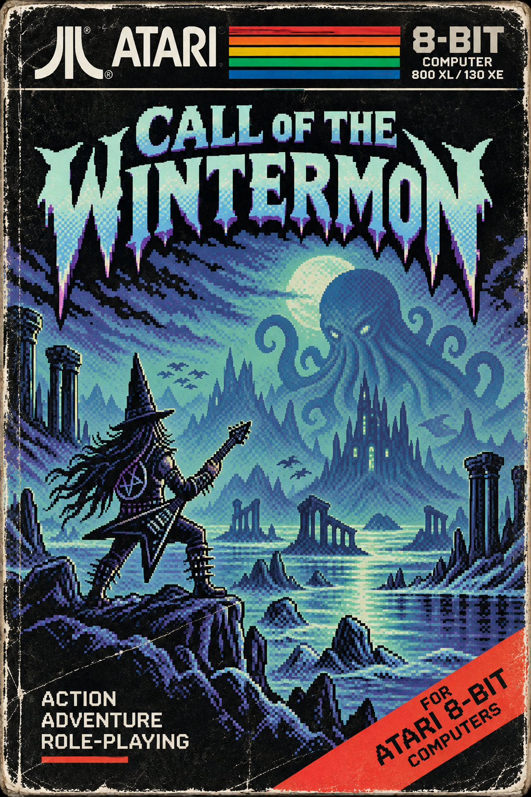

# Call of the Wintermon

Projekt gry platformowej na komputery **Atari 8-bit (XL/XE)** w architekturze 6502 assembly (MADS) zintegrowanej z zaawansowanym pipeline'em narzędziowym w Pythonie.



## Fabuła

To miał być rutynowy koncert.

Wommbath dawał popis growlu na scenie zamku Wintermon. Jednak jego gardłowy śpiew dotarł aż do pradawnych głębin pod górami. Uśpiona od eonów przedwieczna istota usłyszała jego śpiew i zażądała płyt CD z najlepszym metalem na świecie.

Teraz Wommbath musi zebrać albumy i dostarczyć je, nim nadejdzie świt!

---

## Architektura gry i silnika Atari 8-bit

Plik wynikowy `call_of_the_wintermon.xex` został zaprojektowany z myślą o komputerach Atari 800XL / 65XE z 64 KB RAM (kod, grafika i bufory mieszczą się ściśle w przestrzeni użytkownika `$2000`–`$BFFF` poniżej pamięci OS ROM i rejestrów sprzętowych `$C000`–`$DFFF`):

- **Ekran tytułowy**:
  - Grafika bitmapowa ANTIC Mode D Narrow (128 × 96 pikseli, 2 bpp).
  - Płynny hardware scroller (ANTIC Mode 2, bufor 48 bajtów, drobne przewijanie `HSCROL`).
  - Tęczowy gradient tła (8 scanlinii w rejestrze `COLPF2` synchronizowanych `WSYNC` w przerwaniu DLI).
  - Odtwarzanie utworu tytułowego na silniku audio POKEY.
- **Ekran wprowadzający (Intro)**:
  - 12-wierszowy tekst wprowadzający w trybie ANTIC Mode 2 z dedykowanym zestawem znaków (1 KB font w `$2400`).
  - Dedykowana ścieżka muzyczna intro skompilowana z notacji DSL.
- **Rozgrywka (Gameplay)**:
  - Ekran rozgrywki w trybie ANTIC Mode D (160 × 96 pikseli).
  - Dynamiczny silnik DLI z podwójnym buforowaniem (`engine/dli.asm`), ustawiający palety i rejestry GTIA per wiersz.
  - Cztery arkusze kafelków otoczenia w trybie ANTIC Mode E (`$8000`–`$BF6C`).
  - Postać bohatera renderowana sprzętowo jako Player 0 w pojedynczej rozdzielczości PMG (256 bajtów bufora scanlinii).
  - Sekrety (płyty CD, klucze) renderowane w pamięci Missiles (M0–M3) z 4-krotnym powiększeniem szerokości (`SIZEM`).
  - Prezentacja karty tytułowej sceny z płynnym rozjaśnianiem (`fade-in`) i wygaszaniem (`fade-out`).
- **Fizyka i kolizje**:
  - Model ruchu gracza z inercją (subpikselowa akceleracja i wyhamowywanie).
  - Trzy trajektorie skoków: skok pionowy w miejscu, skok krótki w bok oraz wysoki skok na wyższe platformy.
  - Zabezpieczenie przed skakaniem pod niskim sufitem i ochrona przed zahaczaniem o platformy oddalone o 2 poziomy.
  - Detekcja krawędzi platformy, grawitacja i naturalne spadanie.
  - Sprzętowa detekcja kolizji GTIA (rejestry `M0PL`–`M3PL` filtrowane obwiednią 2D).
  - Wielopoziomowe łańcuchy sekretów: odblokowywanie kolejnych etapów po zebraniu kompletu obiektów bieżącej grupy.
- **Linia statusowa (HUD)**:
  - Stały wiersz tekstu ANTIC Mode 2 na dole ekranu.
  - Licznik pozostałych żyć (serca o kodzie wewnętrznym 64).
  - Nazwa bieżącej sceny wyrównana do lewej od kolumny 4 (kolumny 0–2: życia, kolumna 3: odstęp, kolumny 38–39: licznik CD).
  - Dwucyfrowy licznik zebranych płyt CD (`00`–`99`).
- **Ekran końca gry**:
  - Obsługa stanów `GAME_FAILED` (porażka) oraz `GAME_SUCCESS` (zwycięstwo) z dedykowanymi wierszami poezji i bezpiecznym powrotem do ekranu tytułowego.

---

## Sterowanie

| Ruch / Klawisz | Akcja |
|---|---|
| **Joystick Lewo / Prawo** | Chodzenie w lewo / w prawo (z płynną inercją) |
| **FIRE (bez wychylenia)** | Skok pionowy w górę |
| **FIRE + Lewo / Prawo** | Skok krótki w przód (pokonywanie małych przerw) |
| **FIRE + Góra + Lewo / Prawo** | Skok długi w górę (wskakiwanie na wyższy poziom platform) |
| **Spacja / FIRE** (na ekranie tytułowym i intro) | Przejście do gry / pominięcie intro |

---

## Narzędzia i komponenty projektu

- **[atari-scene-editor/](atari-scene-editor/README.md)**: Wizualny edytor scen platformowych w PySide6. Umożliwia wycinanie kafelków z arkuszy graficznych, obsługę orientacji `flip_x`, układanie platform, definiowanie sekretów i wrogów, zarządzanie zależnościami etapów (`dep_id`), podgląd DLI oraz eksport do formatu JSON.
- **[sprite_studio/](sprite_studio/)**: Narzędzie GUI w PySide6 do projektowania, animacji i edycji klatek sprite'ów PMG Atari 8-bit (Player/Missile) ze schowkiem ramek i importem grafik.
- **Pipeline skryptów (`scripts/`)**:
  - `convert_image.py` — konwerter obrazów PNG na format bitmapy ANTIC Mode D Narrow (128 × 96).
  - `convert_tiles.py` — konwerter arkuszy graficznych na binaria kafelków ANTIC Mode E (160 × 96, 2 bpp).
  - `compile_scenes.py` — kompilator definicji scen z JSON do zoptymalizowanych struktur Structure-of-Arrays (SoA) w asemblerze 6502 (`gen/scenes_data.asm`, `gen/scenes_dli_data.asm`).
  - `compile_sprites.py` — kompilator modeli sprite'ów do tabel asemblera (`gen/sprites_data.asm`, `gen/player_sprites.asm`).
  - `compile_music.py` — kompilator ścieżek muzycznych w formacie DSL oraz JSON do formatu odtwarzacza POKEY.
  - `compile_scroll_text.py` — kompilator tekstu płynnego scrollera do wewnętrznych kodów ekranowych Atari.
  - `check_memory.py` — audytor poprawności mapy pamięci RAM, badający nakładanie się segmentów i dostępny margines do granicy `$C000`.
  - `generate_memory_map.py` — generator raportów i wizualizacji mapy pamięci XEX (w formacie PDF i konsolowym).

---

## Instalacja i uruchomienie

### 1. Wymagania systemowe
- Python 3.10+
- Asembler [MADS](https://mads.atari8.info/) (w ścieżce systemowej lub skonfigurowany w `Makefile`)
- Emulator [Altirra](https://www.virtualdub.org/altirra.html) (do uruchamiania pliku XEX)

### 2. Przygotowanie środowiska Python
```bash
python -m venv .venv
.venv\Scripts\Activate.ps1   # PowerShell (Windows)
# lub: source .venv/bin/activate  (Linux/macOS)

pip install -r requirements.txt
```

### 3. Budowanie projektu za pomocą `make`
W głównym katalogu projektu dostępny jest `Makefile` automatyzujący cały proces:

```bash
# Pełna kompilacja zasobów, kodu, testów i walidacji pamięci:
make all

# Tylko kompilacja pliku wykonywalnego XEX:
make xex

# Uruchomienie pełnego pakietu 430+ testów automatycznych:
make tests

# Sprawdzenie układu pamięci i wolnego miejsca poniżej $C000:
make check_memory

# Wygenerowanie wizualnej mapy pamięci do pliku memory_map.pdf:
make map

# Uruchomienie skompilowanej gry w emulatorze Altirra:
make run

# Wyczyszczenie wygenerowanych plików:
make clean
```

---

## Uruchamianie edytorów graficznych

### Atari Scene Editor
```bash
atari-scene-editor
# lub:
python atari-scene-editor/main.py
```

### Sprite Studio
```bash
python sprite_studio/main.py
```

---

## Testy automatyczne

Projekt objęty jest zestawem ponad 430 zautomatyzowanych testów `pytest`:
- **Testy emulacji 6502 (py65)**: Weryfikują działanie kodu asemblera bezpośrednio w emulowanym procesorze 6502 (ruch gracza, trajektorie i blokowanie skoków, fizyka spadania, kolizje z sufitami i platformami, silnik sekretów, linia statusowa, DLI, maszyna stanów gry).
- **Testy jednostkowe narzędzi Python**: Badają poprawność kompilacji scen, modeli Pydantic, reguł wierszy sekretów, importu i eksportu danych oraz konwersji grafik.

Uruchomienie wszystkich testów:
```bash
pytest
```
lub przez Makefile:
```bash
make tests
```

---

## Powiązania sprite'ów (Model numerycznego `sprite_id`)

Sprite Studio oraz Scene Editor łączą się wyłącznie poprzez numeryczny identyfikator `sprite_id` (liczba całkowita).

- **Pliki autorskie vs pliki generowane**:
  - *Pliki autorskie* (edycja ręczna / przez edytory GUI): `sprites/objects.sprite.json`, `scenes/definitions.json`, pliki scen `scenes/*.json`.
  - *Pliki generowane* (przebudowywane przez `make`, nie edytować ręcznie): `gen/definitions_resolved.json`, `gen/sprites_data.asm`, `gen/sprites_manifest.json`, `gen/scenes_data.asm`.
- **Klucz powiązania**:
  - Jedynym kluczem powiązania typu obiektu w katalogu lub nadpisania w scenie ze sprite'em jest `sprite_id`.
  - Nazwy sprite'ów (pole `description` w JSON sprite'ów) pełnią wyłącznie rolę etykiety pomocniczej dla człowieka i nie biorą udziału w walidacji ani w logice gry.
- **Workflow przy celowej zmianie numeracji w Sprite Studio**:
  - Po zmianie numerów ID sprite'ów w Sprite Studio należy otworzyć Scene Editor (`Ctrl+K`), w oknie katalogów ponownie wskazać sprite dla każdego wpisu z listy rozwijanej i zapisać zmiany (`Ctrl+S`).
  - Jeśli `sprite_id` nie istnieje w pliku sprite'ów, proces budowy (`make`) zgłosi błąd z listą dostępnych ID i nazw pomocniczych.
  - Przeniesienie sprite'a pod numer zajęty przez inny sprite nie jest wykrywane przez resolver (obiekty automatycznie przyjmą nowy wygląd przypisany do danego numeru).
  - Obiekty sceny nie zapisują pola `sprite_id`, jeśli ich powiązanie jest identyczne z domyślnym z katalogu.
